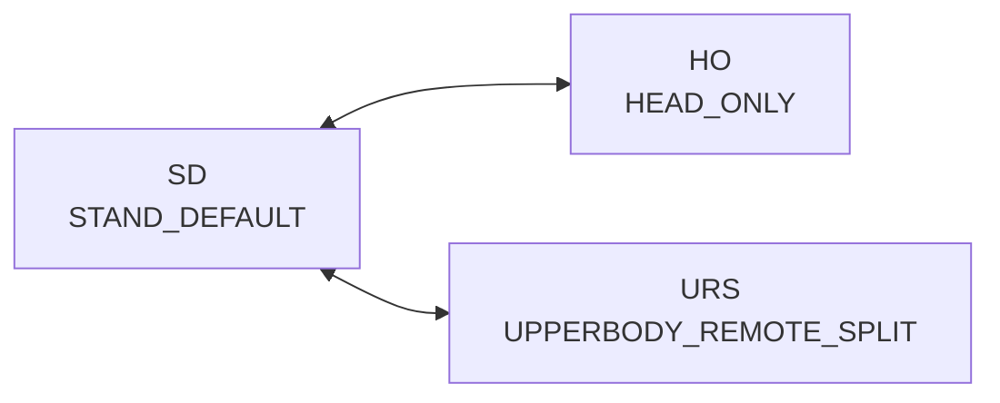

# 🧪 SDK examples — what they do and how to use them

The examples are in `~/aimdk/src/py_examples/py_examples/` (Python) and `~/aimdk/src/examples/src/` (C++).
Almost all of them exist in both versions with the same name:

```bash
ros2 run py_examples <name>     # Python version
ros2 run examples <name>        # C++ version
```

The SDK is loaded automatically in every new terminal: no `source` is needed to run the examples.

## Safety rules

> [!CAUTION]
> ### 🛑 These examples move the robot
>
> The 3 motion examples in [section 2](#2-moving-the-head-and-arms) (`head_control`, `arm_control`,
> `preset_motion_client`) move the robot.
>
> - 👨‍🏫 Run them **only with the instructor present** and with the robot standing in a clear area.
> - ⏹️ To stop an example: `Ctrl+C`.
> - 1️⃣ Run **one node at a time** (at most 2 per second): too many nodes at once can make the robot
>   lose its balance.

> [!CAUTION]
> ### 🚫 Never try to make the robot walk or move its legs
>
> Not with the examples, not with your own code (locomotion topics, direct commands to the leg
> joints, whole-body animations). **You may only move the head and arms**, in the ways described in
> this guide.

---

## 1. Robot modes

The robot has several **control modes**: moving the head or the arms requires the right mode.

### The only allowed modes

For safety reasons you may use **only these three** modes:

| Code | Mode | What it is for |
|---|---|---|
| `SD` | `STAND_DEFAULT` | stable standing, the robot keeps its balance on its own |
| `HO` | `HEAD_ONLY` | head control |
| `URS` | `UPPERBODY_REMOTE_SPLIT` | arm control |

> [!CAUTION]
> ⚠️ **Do not try any other mode** (even if you find it in the documentation): **they make the robot fall**.

### In which order

1. **Always** start from `SD`.
2. From `SD` you go to `HO` (head) **or** to `URS` (arms).
3. To go from `HO` to `URS`, or vice versa, **first go back to `SD`**:
   `SD → HO → SD → URS → SD`.
4. At the end, go back to `SD`.



> [!NOTE]
> **The 3 motion examples in [section 2](#2-moving-the-head-and-arms) (`head_control`, `arm_control`,
> `preset_motion_client`) already perform this whole sequence on their own**: you usually do not need
> to change mode by hand. If you write your own code, follow the same order (copy the
> `set_mode` function from `head_control` or `arm_control`).

### Viewing or changing the mode by hand

| Example | What it does | Usage |
|---|---|---|
| `get_mc_action` | prints the current mode (e.g. `STAND_DEFAULT`) | `ros2 run py_examples get_mc_action` |
| `set_mc_action` | changes mode (accepts only `SD`, `HO`, `URS`) | `ros2 run py_examples set_mc_action SD` |

`set_mc_input_source` and `get_current_input_source` manage which program has control of the
robot (advanced use, see documentation 5.1.3).

---

## 2. Moving the head and arms

> [!CAUTION]
> 🛑 Instructor present, robot standing in a clear area, one node at a time. See the [safety rules](#safety-rules).

These are the **3 motion examples**: `head_control`, `arm_control` and `preset_motion_client`.
All three put the robot in `STAND_DEFAULT` at the start, switch to the right mode on their own,
and return to `STAND_DEFAULT` at the end (see [section 1](#1-robot-modes)).

### `head_control` — turning the head (right/left)

```bash
ros2 run py_examples head_control 0.2
```

- Argument: **yaw** angle in radians, from `-0.366` to `0.366` (default `0`, head centered).
  Out-of-range values are clamped.
- Sequence: `STAND_DEFAULT` → `HEAD_ONLY` → holds the head in position until you press
  `Ctrl+C` → `STAND_DEFAULT`.

### `arm_control` — putting the arms in a position

```bash
ros2 run py_examples arm_control 0.39 0 0 -1.17 0 0 0  0.39 0 0 -1.17 0 0 0
```

- Arguments: **14 angles in radians**, first the 7 of the left arm, then the 7 of the right,
  in this order: `shoulder_pitch shoulder_roll shoulder_yaw elbow wrist_yaw wrist_pitch wrist_roll`.
- With no arguments, all joints go to `0` (elbows straight). With wrong arguments it prints the
  list of joints with their limits.
- The example line above is the normal standing arm position: start from there and change
  **one value at a time**, by a small amount.
- Sequence: `STAND_DEFAULT` → `UPPERBODY_REMOTE_SPLIT` → holds the position until you press
  `Ctrl+C` → `STAND_DEFAULT` (the arms return to the normal position).

> [!WARNING]
> 🦾 Change **one joint at a time, by small amounts**. Large jumps between positions produce fast,
> wide arm movements.

### `preset_motion_client` — predefined arm gestures

```bash
ros2 run py_examples preset_motion_client
```

It asks for the arm (1 left, 2 right, 3 both) and the gesture number; then the gesture is
performed and the arm returns to position on its own.

| Number | Gesture | Arm |
|---|---|---|
| 1001 | raise hand | 1, 2 |
| 1002 | wave | 1, 2 |
| 1003 | handshake | 1, 2 |
| 1004 | blow a kiss | 1, 2 |
| 1007 | heart | 1, 2, 3 |
| 1008 | high five | 1, 2 |
| 1010 | raise hand | 1, 2, 3 |
| 1011 | wave close to the chest | 1, 2 |
| 1013 | military salute | 1, 2 |

---

## 3. Cameras and sensors

✅ These examples only **read** data: they do not move the robot.

| Example | What it reads | Usage |
|---|---|---|
| `echo_camera_rgbd` | front RGB-D camera (color and depth) | `ros2 run py_examples echo_camera_rgbd --ros-args -p topic_type:=rgb_image` |
| `echo_camera_stereo` | front stereo cameras | `... --ros-args -p topic_type:=left_rgb_image` |
| `echo_camera_head_rear` | rear head camera | `... --ros-args -p topic_type:=rgb_image` |
| `take_photo` | saves a `.png` image from the left stereo camera into the `images/` folder | `ros2 run py_examples take_photo` |
| `echo_lidar_data` | chest lidar (points or IMU) | `... --ros-args -p topic_type:=pointcloud` |
| `echo_head_touch_sensor` | touch sensor on the head | `ros2 run py_examples echo_head_touch_sensor` |
| `echo_imu_data` | IMU (accelerations and rotations) | `ros2 run examples echo_imu_data` |
| `echo_gnss_data` | GPS | `ros2 run examples echo_gnss_data` |

For the camera examples, the possible values of `topic_type` are listed at the top of the
source file. To **view** the images, Foxglove is more convenient
([student guide, section 6](STUDENT-GUIDE.md#6-visualizing-data-with-foxglove)).

### `yolo_detection` — detecting objects with the camera (Python only)

```bash
ros2 run py_examples yolo_detection
```

It takes images from the front camera, detects objects with the YOLO model (on the GPU), and
publishes the images with bounding boxes on the `/yolo/image/compressed` topic: open it in Foxglove
with an **Image** panel. Every 5 seconds it prints the frames per second and the detected objects.

Useful parameters (`--ros-args -p name:=value`):

- `conf:=0.5` confidence threshold (default `0.25`): higher = fewer but more reliable boxes;
- `input_topic:=/aima/hal/sensor/rgbd_head_front/rgb_image/compressed` to use the RGB-D camera
  (in that case add `-p decode_scale:=1`);
- `model:=...` a different YOLO weights file.

---

## 4. Audio

| Example | What it does | Usage |
|---|---|---|
| `play_tts` | the robot says a sentence | `ros2 run py_examples play_tts "Ciao a tutti"` |
| `play_audio` | plays an audio file | `ros2 run py_examples play_audio` (asks for the path; Enter = default test file) |
| `play_audio_stream` | plays a raw audio file (16 kHz PCM) by sending it in chunks | `... --ros-args -p raw_audio_path:=<file>` |
| `get_mic_source` | tells which microphone is active (internal or external) | `ros2 run py_examples get_mic_source` |
| `set_mic_source` | selects the microphone | `ros2 run py_examples set_mic_source int` (or `ext`) |
| `mic_receiver` | saves the sentences detected by the robot into `audio_recordings/` (`.pcm` files) | `ros2 run py_examples mic_receiver` |
| `mic_raw_receiver` | saves the raw audio of all microphone channels (`.pcm` files) | `ros2 run py_examples mic_raw_receiver` |

`.pcm` files have no header: you can open them, for example, with Audacity
(*File → Import → Raw Data*, signed 16-bit, 16000 Hz, 1 channel).

### `audio_transcriber` — transcribing what is said to the robot (Python only)

```bash
ros2 run py_examples audio_transcriber
```

Speak close to the robot's head. For each detected sentence it:

1. saves a `.wav` file (you can listen to it while the program runs: the folder is printed
   at startup);
2. transcribes the sentence with Whisper (on the GPU) and prints it;
3. publishes the text on the `/audio/transcription` topic (in Foxglove: **Raw Messages** panel).

> [!WARNING]
> 🗑️ The `.wav` folder **is deleted when you close the program**. Copy anything you want to keep before pressing `Ctrl+C`.

Parameters: `-p language:=en` for another language (default `it`), `-p model:=base` for a faster
but less accurate model (default `small`). The first time, the model is downloaded (a few
minutes).

---

## 5. Display and lights

| Example | What it does | Usage |
|---|---|---|
| `play_emoji` | shows an expression on the face display | `ros2 run py_examples play_emoji` (asks for number and mode) |
| `play_video` | plays a video on the display | `ros2 run py_examples play_video` |
| `play_lights` | changes color and effect of the LED strip | `ros2 run py_examples play_lights` (asks for mode 0-3 and color) |

---

## 6. Diagnostics

| Example | What it does | Usage |
|---|---|---|
| `hds_diagnostics` | shows the robot's alarms and diagnostics in real time, or the history | `ros2 run py_examples hds_diagnostics echo` / `... history` |
| `migrate_system_state` | changes the robot's system state | ⛔ **do not use** without the instructor |

> [!CAUTION]
> ⛔ `migrate_system_state` changes the robot's system state: **never run it without the instructor**.

---

## Using an example as a starting point

Copy the example into a package of your group's ROS 2 workspace, register it and rebuild: see
[STUDENT-GUIDE.md → Starting from an SDK example](STUDENT-GUIDE.md#4-starting-from-an-sdk-example).

> [!IMPORTANT]
> ✋ Do not modify the original examples in `~/aimdk`: everyone uses them.
